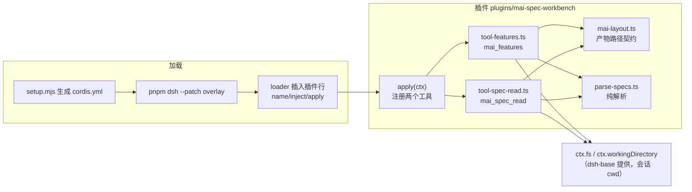

# my-ai-infra SDD 工作台只读插件 技术方案

> Feature：999 | 有效需求来源：[spec/PRD.md](../spec/PRD.md)（AC-01～AC-06） | Profile：standard | 模板：项目 `mai-specs/_templates/TECH_DESIGN.tmpl.md` | 代码基线：master @ ca33fd6843 | 状态：待评审

## 需求依据与验收

范围与 AC 以 [PRD](../spec/PRD.md) 为唯一维护源：FR-01（mai_features 导航与验收摘要）、FR-02（mai_spec_read 规格读取）、FR-03（setup 生成 overlay）、BR-01～BR-05、NFR-01/02、AC-01～AC-06。本方案不重复业务规则，仅做实现映射。

## 1. 方案概述

### 1.1 设计目标和设计原则

- 当前用户路径：`node plugins/mai-spec-workbench/setup.mjs` 一次生成本机 overlay → `pnpm dsh web --patch plugins/mai-spec-workbench/cordis.yml`（或 headless）→ 会话中模型经 `mai_features`/`mai_spec_read` 两跳完成 SDD 概览与深入。
- 复用：`ctx.tools` 注册管线与 `defineTool` 校验（`@deepseek-ai/dsh-tools`）、`ctx.fs` 文件服务（provider 感知，本地/沙箱/SSH 一致）、`ctx.workingDirectory.ensure(exec.agent)` 会话 cwd、内置 `read` 工具的窗口思想（offset/limit/单行截断）。不新增任何抽象层或服务。
- 硬约束：只读（BR-01）；产物路径契约以 `FEATURE_LAYOUT.json` 优先且损坏即报错（BR-02）；错误可见（BR-03）；单 Feature 宽容、全局失败（BR-04）；overlay 绝对路径由脚本生成（BR-05）。
- 不做：写操作、`mai` CLI 阶段启动、Web 专属卡片、系统提示 section、仓库 `packages/` 变更。

### 1.2 整体架构

新增全部位于仓库根 `plugins/mai-spec-workbench/`（不入 pnpm workspace，不触发仓库门禁）；对既有代码零修改（除 `.gitignore` 追加一行忽略生成的 overlay）。

### 1.3 关键决策与 Review 索引

| 决策 | 推荐及理由 | 代价与备选 | 待判断事项/确认状态 | 详情 |
| ---- | ---------- | ---------- | ------------------- | ---- |
| D1 out-of-tree 插件（非 workspace 包） | 官方教程路径（docs/user/develop/basic/）；fork 作业无需满足产品包门禁（i18n 七语言、README Model Experience、constraints） | 不能进 repo vitest/发布流程；备选 packages/experimental 产品包，代价远超作业范围 | 已确认（PRD 范围） | §2.3.1 |
| D2 解析逻辑独立纯函数模块（parse-specs.ts） | BRIEF 表格与 TEST_PLAN 结果表解析不依赖 cordis/fs，可用 `node:test` 直接单测，无需搭 cordis 测试环境 | 与工具实现分离需保持导出稳定 | 已确认 | CODE_DESIGN §1 |
| D3 FEATURE_LAYOUT.json 损坏即整体报错 | 仓库约定"misconfiguration fails loud"；静默回退默认路径会让自定义布局项目读到错误结论 | 用户需修复 JSON 才能用工具；备选警告+回退，违反 BR-02 | 已确认（BR-02） | CODE_DESIGN §2 |
| D4 验收摘要只计数、不下整体结论 | mai 阶段契约要求"必要项未验证不能给整体通过结论"，该判断属人/编排者 | 模型需自行综合；备选输出结论，属伪造证据 | 已确认（PRD 待确认事项） | CODE_DESIGN §3 |
| D5 read 窗口参数与固定常数上限 | 与内置 read 习惯一致（offset/limit/单行截断），防大文件倾倒；MVP 不引入插件 Config | 上限不可配置（2000 行/2000 字符）；作业场景足够 | 已确认（NFR-01） | CODE_DESIGN §4 |
| D6 纯函数测试用 node:test + tsx，不进 repo vitest | repo vitest 按包聚合扫描 packages/；插件非 workspace 包，独立 runner 零侵入 | 测试命令单独写在 README，CI 不覆盖（fork 作业可接受） | 已确认 | §2.3.4 |

## 2. 详细设计方案

### 2.1 核心结构设计

#### 2.1.1 数据结构设计

新增类型（`src/parse-specs.ts`、`src/mai-layout.ts`，均为插件内部类型，非跨包契约）：

- `ArtifactId = 'brief' | 'prd' | 'design' | 'test-plan' | 'design-review' | 'code-review'`（工具参数枚举同源）。
- `FeatureBrief`：`{ id, title, phase, profile, priority }`，字段缺失时 phase 等为 `undefined`，由工具层落 `unknown` 并记 warning。
- `AcceptanceSummary`：`{ status: 'counted' | 'no-test-plan' | 'no-results', counts?: Record<string, number> }`。
- `FeatureSummary`：`{ id, title, phase, profile, priority, artifacts: Record<ArtifactId, boolean>, acceptance, warnings: string[] }`。
- `SpecWindow`：`{ path, offset, lines: { number, text }[], totalLines }`（对齐内置 read 的 canonical 形状）。

#### 2.1.2 数据流设计

- `mai_features`：定位根目录（见下）→ stat 缺失即 COPY-01 错误 → `listDir` 过滤 `/^\d{3}-/` 目录（升序）→ 逐 Feature：读 BRIEF（缺失 → 全字段 unknown + warning）→ 按契约 stat 六类产物 → 有 TEST_PLAN 则读并解析结果表 → 汇总为 canonical JSON。失败路径：resolve/stat/listDir 抛 FsError 原样上抛（isError）；单 Feature 解析失败不中断（BR-04）。
- `mai_spec_read`：同上定位根目录 → 目录名精确匹配或纯数字编号前缀匹配（唯一）→ 无匹配 COPY-02 → 契约解析产物路径 → stat 缺失 COPY-03 → `readText` → 行窗口化（NFR-01）→ canonical JSON。
- cwd 解析（对齐 `packages/fs/tool-fs/src/session-cwd.ts` 语义）：`exec.agent` 存在时经 `ctx.workingDirectory.ensure(exec.agent, exec.signal)` 取会话 cwd；为 undefined（如 PTC/非 Agent 派发）时 resolve 不携带 cwd，由 fs provider 使用其默认目录。评审 P1-1 修复。
- 取消：全部 fs 调用透传 `exec.signal`（NFR-02）。

#### 2.1.3 接口设计

两个模型工具（唯一对外接口；schema 见 CODE_DESIGN §5）：

- `mai_features`：无参数；output 为 `{ root, features: FeatureSummary[] }`；render 为人类可读摘要文本。
- `mai_spec_read`：`feature: string`、`artifact: ArtifactId`、`offset?: number`、`limit?: number`；output 为 SpecWindow 形状；render 为 `<path>` 元信息 + 行号正文。
- 预期失败：`ToolArgsError`（参数约束）与 `HarnessError` 子类 `MaiWorkbenchError`（code：`MAI_SPECS_NOT_FOUND` / `MAI_FEATURE_NOT_FOUND` / `MAI_ARTIFACT_NOT_FOUND` / `MAI_LAYOUT_INVALID`）。

### 2.2 配置变更

无插件配置项（D5：常数上限；无 cordis.yml config）。`.gitignore` 追加 `plugins/mai-spec-workbench/cordis.yml`（BR-05，setup 产物不入库）。

### 2.3 分模块详细设计

#### 2.3.1 插件入口与加载（src/index.ts、setup.mjs）

`index.ts` 具名导出 `name = 'mai-spec-workbench'`、`inject = ['tools', 'fs', 'workingDirectory']`、`apply(ctx)`（注册两工具，注册即 effect，随插件卸载自动反注册）。`setup.mjs` 无依赖 Node 脚本：以 `import.meta.url` 定位插件目录，写 `cordis.yml`（`- insert: - id: mai-spec-workbench / name: <绝对路径>/src/index.ts`），幂等。

#### 2.3.2 产物契约（src/mai-layout.ts）

默认映射表 + `FEATURE_LAYOUT.json` 覆盖（读 root 下的该文件；`version !== 1` 或缺 `artifacts` 数组 → `MAI_LAYOUT_INVALID`）。暴露 `artifactPaths(layout)` 与 `loadLayoutJson(text)`（纯函数，可单测）。

#### 2.3.3 解析（src/parse-specs.ts）

`parseBrief(text)`（标题 `# {id}: {title}`、两列表格取 Phase/Profile/优先级）、`parseAcceptanceResults(text)`（定位 `## 执行结果` 节、按表头"结果"列计数，五种已知取值 + 其他）、`windowLines(text, offset, limit)`（行号窗口与单行截断）。全部纯函数。

#### 2.3.4 测试（tests/parse.test.ts）

`node --import tsx/esm --test`：覆盖 BRIEF 正常/缺字段/无标题、结果表计数/缺省态/未知值、窗口边界（offset 越界、limit 上限、超长行）、布局契约（覆盖/损坏/version 不符）。

### 2.4 供评审的代码设计（for review check）

关键类型、错误模型、两工具 schema 与全部核心解析逻辑的代码骨架见 [CODE_DESIGN.md](CODE_DESIGN.md)（片段为设计示意，验证状态以 §5 任务与 TEST_PLAN 执行结果为准）。评审重点：D3 布局失败语义、D4 计数口径、read 窗口边界、目录匹配的唯一性规则。

## 3. 风险评估

| 风险与触发条件 | 影响 | 缓解措施 | 验证方式 |
| -------------- | ---- | -------- | -------- |
| tsx paths 解析只在仓库 checkout 内生效（D1 依赖根 tsconfig.base.json） | 插件目录被移出仓库后 bare import 失败 | README 明确"插件须位于本仓库 checkout 内运行" | AC-06 |
| my-ai-infra 升级改变 BRIEF/TEST_PLAN 模板 | phase/优先级解析退化 | 解析宽容 + warnings 如实呈现（BR-04），不中断 | 单测锁当前格式 + 缺字段用例 |
| FEATURE_LAYOUT.json 版本演进（version > 1） | 产物路径判定失败 | version 不符即 MAI_LAYOUT_INVALID，报错指明文件 | 单测 |
| 大量 Feature 时逐个读两文件 | mai_features 变慢 | 每目录最多 2 次小文件读；作业规模（个位数 Feature）无感 | 手工验证 |

## 4. 兼容性考量

无既有调用方（全新插件目录）；不修改仓库任何既有文件行为。唯一仓库内变更（.gitignore 追加）不影响任何工具链。插件加载依赖 DSH 源码启动契约（tsx + 根 tsconfig paths），随仓库版本演进由 AC-06 的 dump-config 步骤兜底验证。

## 5. 任务分解

| 任务 | 关联模块/决策 | 变更文件（新增/修改/删除） | 前置依赖 | 交付物与验收条件 |
| ---- | ------------- | -------------------------- | -------- | ---------------- |
| T1 契约与解析纯函数 | D2、D3、D4 | + `plugins/mai-spec-workbench/src/mai-layout.ts`、`src/parse-specs.ts` | 本方案评审通过 | 纯函数可单测；AC-02/05 的解析分支就绪 |
| T2 工具与插件入口 | D1、D5 | + `src/tool-features.ts`、`src/tool-spec-read.ts`、`src/index.ts` | T1 | 两工具注册；错误码齐备（BR-03） |
| T3 setup 与忽略项 | BR-05 | + `setup.mjs`；M `.gitignore` | 无 | 幂等生成 overlay；AC-06 |
| T4 单元测试 | D6 | + `tests/parse.test.ts` | T1 | `node --import tsx/esm --test` 全绿，覆盖 AC-02/03/04/05 解析侧 |
| T5 插件 README | 作业要求 | + `plugins/mai-spec-workbench/README.md` | T2、T3 | 安装/配置/启动/验证命令可照跑 |
| T6 端到端验收 | AC-01/03/04/06 | 无新文件（证据留档 TEST_PLAN） | T2～T5、`.env` key | dump-config、headless 真实会话各一次成功并留档 |
