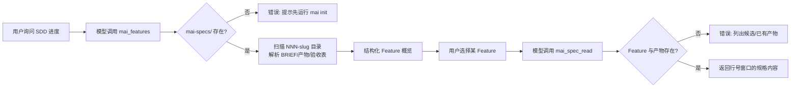

# PRD：my-ai-infra SDD 工作台只读插件

> 状态：待评审 | 负责人：xiaonan chen

[返回需求简报](../BRIEF.md)

## 1. 背景与目标（Why）

- **背景/痛点**：DSH 会话中的模型要了解项目的 SDD 进度，只能用通用 `read`/`glob` 工具逐层翻找 `mai-specs/`：不知道 Feature 目录命名规则（`NNN-slug`）、BRIEF 的 Phase/Profile 字段位置、各阶段产物的默认路径，也不知道验收状态记录在 `TEST_PLAN.md` 的执行结果表里。一次"列出所有 Feature 并汇总验收状态"需要多跳猜测式调用，易漏易错。
- **目标**：为 DSH 提供一个开箱即用的只读插件（`plugins/mai-spec-workbench`），通过两个模型工具把 SDD 工作区结构显式暴露给模型：`mai_features` 做 Feature 导航与验收摘要，`mai_spec_read` 按语义入口（Feature + 产物类型）读规格文档。
- **成功指标**：按 README 步骤执行后，`pnpm dsh` 能加载插件；模型一句话即可完成"列出 Feature 及验收状态"（此前需多跳通用工具调用）；真实模型会话中两个工具各成功完成一次任务（验收证据留档）。

## 2. 用户与场景（Who / When）

| 用户故事 ID | 目标用户 | 触发场景 | 用户故事：作为…我希望…以便… | 关联需求 |
|---|---|---|---|---|
| US-01 | DSH 使用者（开发者） | 会话中询问 SDD 进度 | 作为 DSH 用户，我希望让模型一句话列出项目所有 SDD Feature 的阶段、产物状态与验收摘要，以便快速掌握需求交付进度 | FR-01 |
| US-02 | DSH 使用者（开发者） | 会话中深入某个需求 | 作为 DSH 用户，我希望让模型按 Feature 编号和产物类型直接读到对应规格文档，以便围绕规格继续讨论或实现 | FR-02 |
| US-03 | DSH 使用者（开发者） | 首次在项目中启用插件 | 作为 DSH 用户，我希望一条 setup 命令生成可用的加载配置并按 README 启动，以便零手工编辑 YAML 用上插件 | FR-03 |

## 3. 总体业务流程

### BF-01：查看 SDD 进度

**参与者与起止**：用户在 DSH 会话中提问 → 模型调用 `mai_features` → 一次性返回全部 Feature 的结构化概览，会话继续（可自然接续 `mai_spec_read` 深入）。

**流程说明**：正常路径两跳完成"概览 → 深入"；每个失败分支都带回可执行的下一步信息（见 FR-01/FR-02 的错误输出）。引用 BR-01～BR-04。

## 4. 功能需求（What）

### 4.1 新增需求

| 需求编号 | 触发条件 | 输入 | 预期行为 | 输出/结果 | 关联需求编号 |
|---|---|---|---|---|---|
| FR-01 | 模型需要了解项目 SDD 全貌 | 无参数 | 在会话工作目录（`ctx.workingDirectory.ensure`）下解析 `mai-specs/`；列出所有 `NNN-slug` 目录；逐个读取 `BRIEF.md` 解析编号、标题、Phase、Profile、优先级；按产物契约检查各产物文件存在性；存在 `TEST_PLAN.md` 时解析 `## 执行结果` 表并统计结果计数；全部文件访问经 `ctx.fs` 执行 | 结构化 Feature 列表：每项含 id/title/phase/profile/priority/artifacts 存在标记/acceptance 计数摘要（含"无测试计划"与"有计划未回填结果"两种缺省态）；经 output schema 校验的 canonical JSON + 模型可读文本渲染 | BR-01、BR-02、BR-04 |
| FR-02 | 模型需要读取某 Feature 的具体规格 | `feature`（Feature 编号或目录名，精确匹配）；`artifact`（brief/prd/design/test-plan/design-review/code-review 之一）；可选 `offset`（默认 1）、`limit`（默认 2000，上限同值） | 匹配唯一 Feature 目录；按产物契约解析产物文件路径；经 `ctx.fs` 读取 UTF-8 文本；返回行号窗口 | 结构化结果：path/offset/lines（含行号）/totalLines；模型可读渲染为带元信息的正文 | BR-01、BR-02、BR-03、NFR-01 |
| FR-03 | 用户要在本机启用插件 | 无（运行 `node plugins/mai-spec-workbench/setup.mjs`） | 在插件目录生成本机绝对路径的 `cordis.yml` overlay（插入插件行）；幂等重跑 | 生成/更新 `plugins/mai-spec-workbench/cordis.yml`，配合 `pnpm dsh <profile> --patch plugins/mai-spec-workbench/cordis.yml` 加载 | BR-05 |

### 4.2 变更需求

无（新插件，不触碰仓库既有行为）。

## 5. UI 视觉与交互（按需）

省略：本需求为模型工具插件，无 Web 界面变更；工具调用在既有通用卡片中展示（标题与文件位置信息由工具提供）。

## 6. 业务规则与约束（Rules）

| 规则 ID | 业务规则、状态流转、权限或数据约束 | 关联需求 |
|---|---|---|
| BR-01 | 只读约束：两个工具不得写、建、删任何文件；所有读取经 `ctx.fs` provider 执行（本地/沙箱/SSH 世界一致），并传递 `exec.signal` 支持取消 | FR-01、FR-02 |
| BR-02 | 产物路径契约：`mai-specs/FEATURE_LAYOUT.json` 存在且可解析时，产物路径以其 `artifacts` 为准（按 artifact id 匹配）；该文件不存在时使用内置默认路径（prd→spec/PRD.md、design→design/TECH_DESIGN.md、test-plan→test/TEST_PLAN.md、design-review→review/design_review.md、code-review→review/code_review.md、brief→BRIEF.md 恒定）。文件存在但解析失败时报错并指明文件路径，不得静默回退默认路径 | FR-01、FR-02 |
| BR-03 | 错误可见：`mai-specs/` 缺失 → 明确报错并提示先运行 `mai init`；Feature 不匹配 → 报错并列出现有候选；产物文件缺失 → 报错并列出该 Feature 实际存在的产物。所有预期失败使用带稳定 code 的工具错误 | FR-01、FR-02 |
| BR-04 | 单点宽容、整体失败：单个 Feature 的 BRIEF 解析失败（缺失/字段无法识别）不中断列表，该项以 `phase: "unknown"` 与警告字段如实呈现；`mai-specs/` 本身缺失或 FEATURE_LAYOUT.json 损坏属全局错误，整体报错 | FR-01 |
| BR-05 | overlay 中插件路径必须为绝对路径（DSH loader 契约：`--patch` 不改变模块解析基准目录），因此 `cordis.yml` 由 setup 脚本按本机生成，不提交版本库（.gitignore 登记）；仓库内提交的是 setup 脚本与插件源码 | FR-03 |

| 非功能 ID | 性能、可靠性、安全或可访问性要求 | 适用条件与验证口径 |
|---|---|---|
| NFR-01 | `mai_spec_read` 单次返回不超过 2000 行；单行超过 2000 字符时截断并以省略标记收尾；结果包含 totalLines 供续读 | 任意输入；单测覆盖超长行与超限行数 |
| NFR-02 | 工具在 `exec.signal` 触发时中止未完成 I/O 并以取消错误返回 | 调用中途取消；实现层将 signal 传入全部 ctx.fs 调用 |

## 7. 范围与边界（Scope）

- **包含**：FR-01～FR-03；插件源码、setup 脚本、纯函数单测、插件 README（作业要求的安装/配置/启动/验证说明）；SDD 过程产物（本目录）。
- **不包含**：写操作与流程阶段启动（调用 `mai` CLI 推进 SDD 阶段）；对仓库 `packages/` 的任何修改；Web 专属工具卡片；`ROADMAP.md` 状态解析（Phase 以 BRIEF 为准）。
- **依赖**：DSH 源码启动（`pnpm dsh`，tsx 经根 tsconfig paths 解析 `@deepseek-ai/*`）；`ctx.fs`、`ctx.workingDirectory`、`ctx.tools` 服务由 `dsh-base` 捆绑提供；真实模型验收需根目录 `.env` 提供 `DEEPSEEK_API_KEY`。

## 8. 研发资源（按需）

| 资源 ID | 类型 | 实际链接/路径或本文位置 | 用途/关联需求 | 确认与核验状态 |
|---|---|---|---|---|
| RES-01 | 调研材料 | [context/research-notes.md](../context/research-notes.md) | mai-specs 结构与 DSH 工具机制依据 | 已核验（2026-11-19，对 my-ai-infra@0.0.15 包内模板与 DSH 源码实证） |
| RES-02 | 参考实现 | `packages/fs/tool-fs/src/read.ts`（DSH 仓库） | 工具定义/窗口渲染/错误处理范式 | 已核验 |

### 最终文案（按需）

| 文案 ID | 位置/触发状态 | 最终文字 | 变量与格式规则 |
|---|---|---|---|
| COPY-01 | mai_features 错误输出（mai-specs 缺失） | `no mai-specs/ workspace found at "<resolved>"; run "mai init" first` | `<resolved>` 为解析出的 mai-specs 显示路径（fs provider 的 displayPath；本地为绝对路径） |
| COPY-02 | mai_spec_read 错误输出（Feature 不匹配） | `feature "<input>" not found; available: <候选逗号分隔列表>` | 候选按编号升序；无候选时为 `(none)` |
| COPY-03 | mai_spec_read 错误输出（产物缺失） | `artifact "<artifact>" of "<matched>" not found; present artifacts: <列表>` | `<matched>` 为实际匹配到的 Feature 目录名；列表为该 Feature 实际存在的 artifact id，按固定顺序 brief, prd, design, test-plan, design-review, code-review；无产物时为 `(none)` |

### 业务枚举与预置数据（按需）

| 枚举/字段 | 值 | 显示名/含义 | 默认、排序、停用或空值规则 |
|---|---|---|---|
| artifact 枚举 | brief/prd/design/test-plan/design-review/code-review | 规格产物类型 | brief 恒映射 BRIEF.md，不受 FEATURE_LAYOUT 影响；其余按契约解析 |
| Feature 目录判定 | `/^\d{3}-/` + 目录 | NNN-slug 命名的需求目录 | 不满足命名的目录与文件忽略；列表按目录名升序 |
| 验收结果计数键 | 通过/失败/未执行/受阻/待核验 | TEST_PLAN 执行结果表的结果列取值 | 仅统计执行结果表内出现取值；其他文本原样计入"其他"计数字段 |

## 9. 验收标准（Acceptance Criteria）

### AC-01：列出 Feature 概览

**关联**：FR-01、BR-01、BR-04

- **Given**：会话工作目录下存在含至少一个 Feature 的 `mai-specs/`（本仓库即满足）
- **When**：模型调用 `mai_features`
- **Then**：返回包含每个 Feature 的 id、标题、Phase、Profile、优先级、六类产物存在标记与验收摘要（计数或缺省态）的结构化列表；`999-mai-spec-workbench` 出现在结果中，Phase 如实呈现 BRIEF 当前值
- **验证方式**：单测（解析函数）+ headless 真实模型会话输出留档

### AC-02：验收摘要的缺省态

**关联**：FR-01、BR-04

- **Given**：某 Feature 无 `TEST_PLAN.md`，或 TEST_PLAN 无 `## 执行结果` 内容
- **When**：调用 `mai_features`
- **Then**：该项验收摘要分别为 `status: "no-test-plan"` 与 `status: "no-results"`，不伪造计数
- **验证方式**：单测覆盖两种缺省与正常计数

### AC-03：读取规格文档

**关联**：FR-02、NFR-01

- **Given**：目标 Feature 与产物存在
- **When**：以 `feature=999`（或目录名）、`artifact=prd`、默认 offset/limit 调用 `mai_spec_read`
- **Then**：返回该 Feature `spec/PRD.md` 的行号窗口、路径与 totalLines；默认窗口 ≤2000 行
- **验证方式**：headless 真实模型会话输出留档；单测覆盖窗口与超长行截断

### AC-04：错误路径

**关联**：BR-03、COPY-01～03

- **Given**：分别构造 `mai-specs/` 缺失（空目录会话）、Feature 编号不存在、产物未生成
- **When**：调用对应工具
- **Then**：三种错误分别输出 COPY-01～03 文案，均为 isError 工具结果而非静默空值
- **验证方式**：单测（路径解析与错误分支）+ headless 会话抽验一种

### AC-05：FEATURE_LAYOUT.json 契约覆盖

**关联**：BR-02

- **Given**：`mai-specs/FEATURE_LAYOUT.json` 将某产物登记到非默认路径且文件在该路径存在
- **When**：调用 `mai_features` / `mai_spec_read`
- **Then**：两工具按契约路径判定与读取；文件损坏时整体报错并指明该文件
- **验证方式**：单测（临时目录构造布局文件）

### AC-06：插件加载与可移植 setup

**关联**：FR-03、BR-05

- **Given**：干净 checkout（无 `cordis.yml`）
- **When**：执行 `node plugins/mai-spec-workbench/setup.mjs` 后 `pnpm dsh --profile web --dump-config --patch plugins/mai-spec-workbench/cordis.yml`
- **Then**：组合配置树中出现 `mai-spec-workbench` 插件行；重跑 setup 幂等；`cordis.yml` 不入版本库
- **验证方式**：命令输出留档；`git status` 确认未跟踪文件被忽略

## 待确认事项

| 问题/假设 | 来源 | 影响的编号/范围 | 是否阻塞 | 决策人/状态 |
|---|---|---|---|---|
| 验收摘要是否输出整体"通过/未通过"结论 | 素材索引开放问题 | FR-01 | 否 | 已决策：不输出。mai 契约要求"必要项未验证不能给整体通过结论"，该判断属人/编排者职责，工具只报计数与缺省态 |
| mai_spec_read 是否需要窗口参数 | 素材索引开放问题 | FR-02 | 否 | 已决策：支持 offset/limit（默认 1/2000），与内置 read 习惯一致，防止大文件倾倒 |

## 变更记录（维护时）

| 日期 | 变更及依据 | 影响的编号/范围 |
|---|---|---|
| 2026-11-19 | 初版，基于 BRIEF 与调研材料 RES-01 | 全部 |
